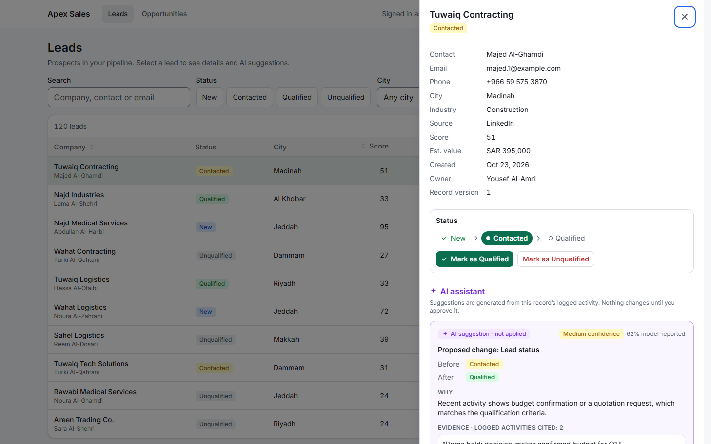
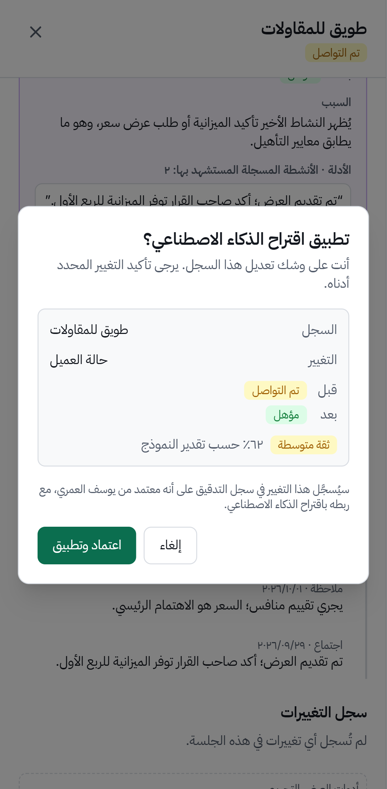

# Apex Sales — AI-assisted sales workspace (frontend prototype)

A bilingual (Arabic / English) lead and opportunity workspace for Saudi SMEs, with an AI assistant that
**proposes** changes and a human who **approves** them. Built as a production-minded prototype for the
Apex AI Arabia Senior Frontend Engineer assessment.

- Runs entirely in the browser against a **mock API** (MSW) — no backend, no credentials, no cloud resources.
- All data is **synthetic** and generated from a fixed seed (fictional companies, `example.com` e-mails).

| English · desktop                                                                | Arabic · mobile                                                                |
| -------------------------------------------------------------------------------- | ------------------------------------------------------------------------------ |
|  |  |

All 20 screenshots (ar/en × desktop/mobile, light and dark) are in [`docs/screenshots`](docs/screenshots).

---

## Quick start

**Requirements:** Node.js **22.12 or newer** (24 LTS recommended) and npm. Google Chrome for E2E tests (see below).

```bash
npm ci
npm run dev          # http://localhost:5173
```

Production build, served locally:

```bash
npm run build
npm run preview      # http://localhost:4173
```

The mock API starts automatically in both modes. Data lives in memory: **reloading the page resets it** to the seed.

## Scripts

| Command                      | What it does                                                                         |
| ---------------------------- | ------------------------------------------------------------------------------------ |
| `npm run dev`                | Vite dev server with HMR and React Query devtools                                    |
| `npm run build`              | Type-check all projects (`tsc -b`) and build to `dist/`                              |
| `npm run preview`            | Serve the production build                                                           |
| `npm run check`              | **Full quality gate:** typecheck + lint + format check + contrast audit + unit tests |
| `npm test`                   | Unit and component tests (Vitest + Testing Library + MSW)                            |
| `npm run test:coverage`      | Unit tests with coverage report (`coverage/index.html`)                              |
| `npm run test:e2e`           | Playwright E2E against the production build (desktop + mobile)                       |
| `npm run e2e:screenshots`    | Regenerate the deliverable screenshots into `docs/screenshots`                       |
| `npm run audit:contrast`     | WCAG contrast check of every design-token colour pair, both themes                   |
| `npm run audit:lighthouse`   | Lighthouse ×3 per page/preset, app-only and simulated (needs `npm run preview`)      |
| `npm run audit:interactions` | Interaction latency at 1× and 4× CPU (needs `npm run preview`)                       |
| `npm run lint`               | oxlint                                                                               |
| `npm run format`             | Prettier (with Tailwind class sorting)                                               |

### E2E browser

Playwright uses the locally installed **Google Chrome** by default, so nothing extra is downloaded.
On a machine without Chrome:

```bash
npx playwright install chromium
PW_CHANNEL=chromium npm run test:e2e        # PowerShell: $env:PW_CHANNEL='chromium'; npm run test:e2e
```

---

## Reviewer demo (≈ 5 minutes)

1. **Bilingual + RTL** — press **العربية** in the header. The layout mirrors, digits become Arabic-Indic, currency is
   shown as ر.س, dates stay Gregorian. Theme: System / Light / Dark switcher next to it.
2. **List views** — filter by status, search, sort by a column header, page through. Everything is in the URL, so the
   view can be shared or reloaded.
3. **AI suggestion** — open **Tuwaiq Contracting** (`/leads?lead=lead-001`). The assistant proposes
   _Contacted → Qualified_ with a confidence band, the evidence it cites (click _Show in timeline_), and its limitations.
4. **Human approval** — _Review & apply…_ opens a confirmation with the exact before/after; focus starts on **Cancel**.
   Approve, and the change is written once and appears in _Change history_ as applied from an AI suggestion.
   A low-confidence example (48 %) that requires an explicit acknowledgement: `/leads?lead=lead-044`.
5. **Roles** — switch to _Read-only Auditor_ (header, or the demo panel on small screens): suggestions can be read
   but not applied, and the API answers 403 even if the UI is bypassed.
6. **Resilience** — open **Demo controls** at the bottom of the page:
   - _Fail every request → 500_: reads retry automatically (3× with backoff), then show an error with _Try again_.
   - _Fail saves only → 500_, then change a lead's status: the change shows instantly, then rolls back with an explanation.
   - In a lead drawer, _Simulate another user editing_ then save: a 409 conflict rolls back and the record refreshes.

The same conditions can be set from the URL: `?latency=slow`, `?latency=none`, `?flaky=0.5`, `?fail=401|403|429|500`,
`?failWrite=500`.

---

## How the requirements are met

| Requirement                                                     | Where                                                                                                                                                                                                                      |
| --------------------------------------------------------------- | -------------------------------------------------------------------------------------------------------------------------------------------------------------------------------------------------------------------------- |
| Lead & opportunity views: sort, filter, paginate, states        | [`features/leads`](src/features/leads), [`features/opportunities`](src/features/opportunities), shared [`DataPanel`](src/components/DataPanel.tsx) (loading / empty / error / refreshing / stale)                          |
| AI panel: grounded, confidence, limitations, evidence, approval | [`features/assistant`](src/features/assistant) — rules in [`policy.ts`](src/features/assistant/policy.ts), the only write path is [`ApprovalDialog`](src/features/assistant/ApprovalDialog.tsx)                            |
| Arabic/English, RTL/LTR, localized dates & numbers, keyboard    | [`i18n`](src/i18n) (typed keys), [`lib/format.ts`](src/lib/format.ts) (cached `Intl`), logical CSS properties throughout, native `<dialog>` focus management                                                               |
| Typed API boundary, latency, 401/403/422, retry                 | [`api/client.ts`](src/api/client.ts) (Zod-validated, single `ApiError` type), [`app/queryClient.ts`](src/app/queryClient.ts) (retry policy), [`mocks`](src/mocks) (latency, auth, roles, validation, fault injection)      |
| Safe optimistic and pessimistic updates                         | Optimistic + rollback: [`useUpdateLeadStatus`](src/features/leads/useUpdateLeadStatus.ts). Pessimistic for AI: [`useApplySuggestion`](src/features/assistant/hooks.ts). Version-based 409 conflict detection on the server |
| Reusable components, design tokens, state management            | [`components/ui`](src/components/ui), [`styles/tokens.css`](src/styles/tokens.css) (`light-dark()` semantic tokens); state model in [ARCHITECTURE.md](docs/ARCHITECTURE.md#state-management)                               |
| Unit/component + E2E tests, a11y audit                          | 53 Vitest tests, 30 Playwright tests (2 user journeys + axe matrix + dialog smoke test) — see [Testing](#testing) and [`docs/evidence`](docs/evidence)                                                                     |

## Documentation

| Document                                  | Contents                                                                             |
| ----------------------------------------- | ------------------------------------------------------------------------------------ |
| [ARCHITECTURE.md](docs/ARCHITECTURE.md)   | Layers, diagrams, state management, API/retry policy, AI safety design, i18n, tokens |
| [AUDIT.md](docs/AUDIT.md)                 | Measured performance (Lighthouse, interactions, bundle) and accessibility results    |
| [DECISIONS.md](docs/DECISIONS.md)         | Decision memo, trade-offs, assumptions, risks and the 90-day roadmap                 |
| [AI-DISCLOSURE.md](docs/AI-DISCLOSURE.md) | How AI assistance was used                                                           |
| [docs/evidence](docs/evidence)            | Raw test runs, Lighthouse JSON, interaction timings, accessibility pass              |

---

## Testing

```bash
npm run check        # typecheck, lint, format, contrast, 53 unit/component tests
npm run test:e2e     # 30 E2E tests: 15 per project (desktop 1440×900, mobile Pixel 7)
```

| Suite                | Count | Highlights                                                                                                                                                      |
| -------------------- | ----- | --------------------------------------------------------------------------------------------------------------------------------------------------------------- |
| AI approval gate     | 9     | cancel writes nothing; approve writes exactly once + audit; low-confidence acknowledgement; viewer blocked; stale suggestion blocked; reopen races after Escape |
| Optimistic updates   | 4     | UI updates before the server answers; immediate rollback on 500 and 409; focus kept                                                                             |
| API boundary & retry | 8     | contract validation; typed errors; reads retry 3×, 4xx never, writes never                                                                                      |
| Policy & domain      | 24    | confidence bands, fail-closed role check, formatting (Arabic digits, Gregorian), backend rules                                                                  |
| Views, i18n, theme   | 8     | URL-synced filters, `aria-sort`, empty/error/recovery, ar/en key parity, RTL switch, theme                                                                      |
| **E2E journey 1**    | 2     | Arabic, keyboard only: filter → open lead → check evidence → back out → approve → verify audit → axe scan                                                       |
| **E2E journey 2**    | 2     | outage → retries → recovery; failed save → rollback; concurrent edit → 409 → rollback → retry succeeds                                                          |
| E2E dialog re-open   | 2     | rapid Escape → Enter re-opens the approval dialog (smoke test; the race is covered deterministically in unit tests)                                             |
| E2E accessibility    | 24    | axe (WCAG 2.2 AA + best practice) on list, opportunities and drawer × ar/en × light/dark × desktop/mobile                                                       |

The tests run against the **same MSW handlers** as the app, so they exercise the real request pipeline (auth, roles,
validation, version checks), not stubs. Key safety tests were verified by deliberately breaking the code and confirming
they fail. Latest run logs: [`docs/evidence`](docs/evidence).

---

## Project structure

```
src/
  api/            Typed boundary: Zod schemas, fetch client, ApiError, endpoints, query keys, shared rules, session
  app/            Shell, router, providers, query client, URL state, theme, demo controls
  components/     Shared: DataPanel, DetailDrawer, LanguageSwitcher, ThemeSwitcher
    ui/           Primitives: Button, Badge, Select, Dialog, Toast, Pagination, SortableHeader, ChipGroup, ...
  features/
    leads/        List, filters, detail drawer, optimistic status control
    opportunities/List, detail drawer, derived values (weighted, overdue)
    assistant/    AI suggestion card, approval gate, safety policy, evidence timeline, audit history
  i18n/           ar/en messages (type-checked against each other), locale hook
  lib/            Formatters (Intl), paged query hook, utilities
  mocks/          MSW handlers, in-memory db with business rules, seed data, fault injection
  styles/         Design tokens
  test/           Vitest setup, MSW server, render helper
tests/e2e/        Playwright specs
scripts/          contrast.mjs (token contrast audit)
docs/             Architecture, evidence, screenshots
```

## Tech stack

React 19 · TypeScript 7 (strict) · Vite 8 · Tailwind CSS 4 · TanStack Query 5 · Zod 4 · i18next · MSW 3 ·
Vitest 5 + Testing Library · Playwright + axe-core · oxlint · Prettier

## Key assumptions

- Records carry names in both Arabic and English (`{ en, ar }`); real CRM data may hold only one.
- Business dates use the Gregorian calendar in both languages; Hijri display is a future preference.
- Authentication is simulated (a user id header); a real deployment would use an httpOnly session cookie.
- "AI" output is pre-generated mock data. The UI treats it as untrusted: it can only propose one of three typed field
  changes, and the server re-validates every apply.
- The mock layer ships in the production build because there is no backend; a real build would gate it behind an env flag.
