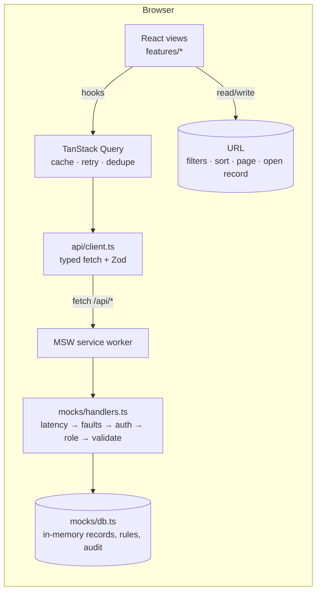
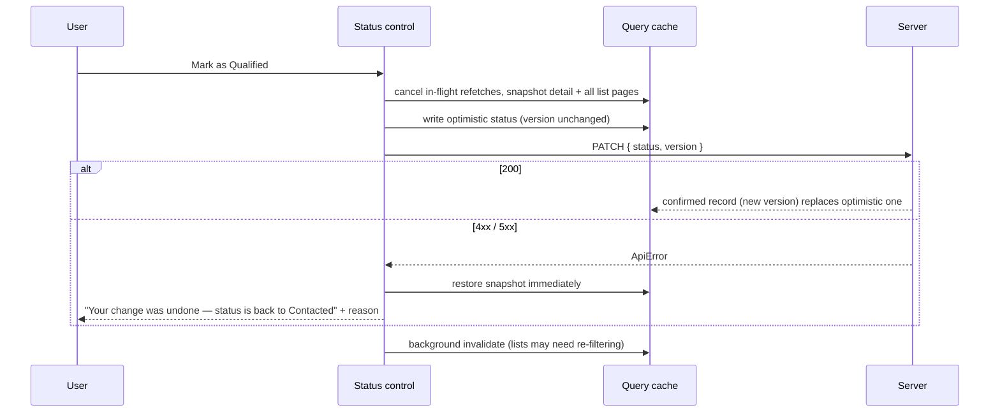
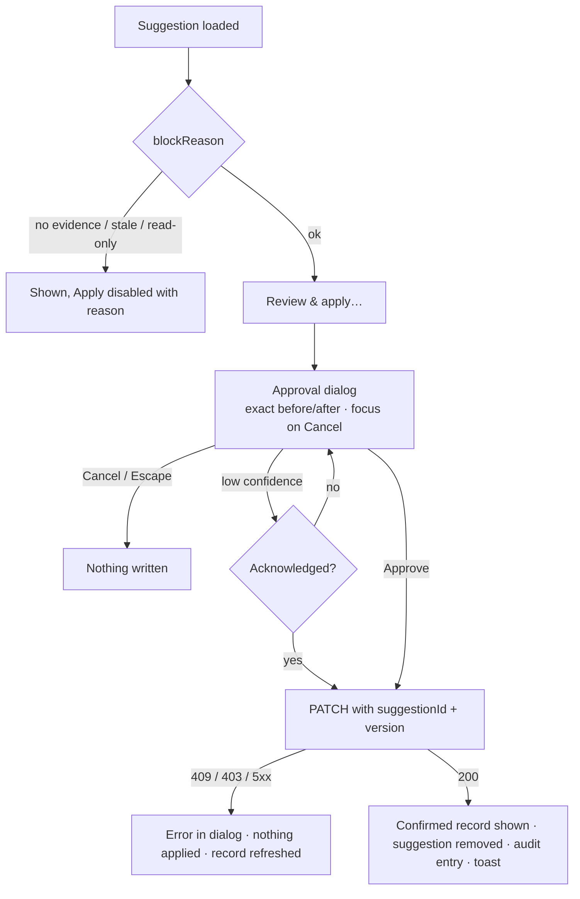

# Architecture

This document explains how the prototype is put together and **why**. For setup and the demo script see the
[README](../README.md).

- [1. System overview](#1-system-overview)
- [2. Layers and dependency rules](#2-layers-and-dependency-rules)
- [3. State management](#state-management)
- [4. API boundary, errors and retries](#4-api-boundary-errors-and-retries)
- [5. Writes: optimistic vs pessimistic](#5-writes-optimistic-vs-pessimistic)
- [6. AI interaction safety](#6-ai-interaction-safety)
- [7. Internationalisation and RTL](#7-internationalisation-and-rtl)
- [8. Design tokens and theming](#8-design-tokens-and-theming)
- [9. Accessibility patterns](#9-accessibility-patterns)
- [10. Performance decisions](#10-performance-decisions)
- [11. Testing strategy](#11-testing-strategy)
- [12. Known limitations](#12-known-limitations)

---

## 1. System overview



The app talks to `/api/*` with ordinary `fetch`. In this prototype a service worker answers those requests; replacing
it with a real backend changes no application code — only the mock layer is removed.

## 2. Layers and dependency rules

| Layer             | Folder           | May import                      | Responsibility                                                     |
| ----------------- | ---------------- | ------------------------------- | ------------------------------------------------------------------ |
| Features          | `src/features/*` | components, api, lib, i18n, app | Screens and feature hooks (leads, opportunities, AI assistant)     |
| Shared components | `src/components` | lib, i18n, api types            | Domain-agnostic UI: `DataPanel`, `DetailDrawer`, `ui/*` primitives |
| API boundary      | `src/api`        | — (zod only)                    | Schemas, client, errors, endpoints, query keys, shared rules       |
| App shell         | `src/app`        | everything above                | Router, providers, query client, theme, URL state, demo tooling    |
| Mock backend      | `src/mocks`      | api (schemas, rules)            | MSW handlers + in-memory database; never imported by features      |

Rules that keep this maintainable:

- **One way to talk HTTP.** Components never call `fetch`; they use hooks, which use `api.*` endpoint functions.
- **One error type.** Anything that crosses the boundary is either schema-validated data or an `ApiError` with a `code`.
- **Business rules have one source.** `api/rules.ts` (e.g. allowed status transitions) is read by the UI to decide what to
  _offer_ and by the backend to decide what to _accept_. The server is the authority.
- **Shared code is extracted on the second use, not the first.** `DataPanel`, `ChipGroup`, `SearchField` and
  `usePagedQuery` were pulled out of the Leads view when Opportunities needed the same behaviour.

<a id="state-management"></a>

## 3. State management

There is no global store library. Each kind of state lives where it belongs:

| Kind                         | Where                                           | Why                                                                        |
| ---------------------------- | ----------------------------------------------- | -------------------------------------------------------------------------- |
| Server data                  | TanStack Query cache                            | Caching, dedupe, background refresh, retry and optimistic updates built in |
| List view state, open record | URL query string (`useUrlQuery`, `useUrlParam`) | Shareable, bookmarkable, survives reload, Back button works                |
| Session, theme, locale       | Small external stores + `useSyncExternalStore`  | Global but tiny; persisted defensively to `localStorage`                   |
| Toasts, modal layer stack    | `toast-store.ts`                                | Callable from mutation callbacks outside React                             |
| Transient UI (form inputs)   | Component `useState`                            | Local by nature                                                            |

Redux/Zustand were considered and rejected: after moving server state into TanStack Query and view state into the URL,
the remaining global client state is a handful of values.

Query keys are hierarchical (`['leads', 'list', query, locale]`, `['leads', 'detail', id]`), so invalidating
`['leads']` refreshes every list page and detail after a write.

## 4. API boundary, errors and retries

Every request goes through the same pipeline in the mock backend, in the order a real gateway would apply it:

```
latency → injected faults (demo controls / URL) → authentication (401) → authorization (403)
        → input validation with the shared Zod schemas (422) → business rules (409 / 422) → response
```

On the client, `request()` guarantees callers receive **Zod-validated data or an `ApiError`** — never `undefined` from a
changed payload. A response that fails its schema becomes `INVALID_RESPONSE` instead of reaching a component.

| Situation                                    | Behaviour                                                                                     |
| -------------------------------------------- | --------------------------------------------------------------------------------------------- |
| Read fails transiently (network, 5xx, 429)   | Retried up to 3× with exponential backoff and full jitter; `Retry-After` respected            |
| Read fails with 4xx                          | Not retried — the error is deterministic and the user needs to see it now                     |
| **Any write fails**                          | **Never auto-retried** — a timed-out write may have succeeded; repeating could apply it twice |
| 401 anywhere                                 | Session marked expired → banner with "Sign in again"                                          |
| 403                                          | Localized "read-only" message; no retry button                                                |
| 409                                          | Optimistic change rolled back; record refetched so the user can retry on the latest version   |
| Background refresh fails with data on screen | Previous rows stay, dimmed, with an explicit "showing previous results" warning               |

## 5. Writes: optimistic vs pessimistic

The app deliberately uses **both** strategies, chosen per write:

| Write                     | Strategy        | Reason                                                                                     |
| ------------------------- | --------------- | ------------------------------------------------------------------------------------------ |
| Manual lead status change | **Optimistic**  | The user's own decision; small, frequent and reversible — instant feedback matters         |
| Applying an AI suggestion | **Pessimistic** | A machine proposal; showing it as applied before the server accepts it would be misleading |



Concurrency: every record has a `version`. Writes send the version they were based on; the server answers **409** if
it changed. AI suggestions also carry the `targetVersion` they were generated against and are refused once stale.

## 6. AI interaction safety

The assistant can never change data on its own. The safety properties and where they are enforced:

| Property                                              | UI                                                                                        | Server / data model                                                               |
| ----------------------------------------------------- | ----------------------------------------------------------------------------------------- | --------------------------------------------------------------------------------- |
| Only a fixed set of reviewable changes                | `ChangeDiff` renders before → after                                                       | `ProposedChange` is a closed union of 3 field changes                             |
| Grounded in evidence                                  | Evidence excerpts link to the cited activity                                              | Suggestions cite only _supporting_ activities; counter-signals become limitations |
| Uncertainty visible                                   | Confidence band (+ raw model score), limitations                                          | Conflicting signals lower the confidence                                          |
| Explicit human approval                               | `ApprovalDialog` is the only write path; focus on Cancel; low confidence needs a checkbox | —                                                                                 |
| No action without evidence / when stale / for viewers | `blockReason()` disables Apply and says why (fails closed while role is unknown)          | 409 for stale suggestion, 403 for viewer                                          |
| Traceability                                          | Change history in the drawer                                                              | Audit entry with suggestion id and approving user                                 |
| No optimistic display                                 | Pessimistic apply; confirmed record written to cache                                      | —                                                                                 |



## 7. Internationalisation and RTL

- **Typed messages.** `ar.ts` is typed against `en.ts`: a missing or extra key fails the build; `t('…')` keys are
  checked. A test also asserts key parity and no empty strings.
- **Direction.** `<html lang dir>` is set before first paint (inline script) and on every language change. All spacing
  and positioning use logical utilities (`ms-`, `pe-`, `inset-e-`, `text-start`), so no RTL-specific CSS exists.
  Direction-dependent icons (chevrons) rotate under `rtl:`.
- **Formatting.** Numbers, currency, percentages, dates and relative times go through cached `Intl` formatters
  (`ar-SA-u-ca-gregory`, `en-SA`). An E2E check asserts the Arabic drawer contains no Latin digits outside elements
  marked `dir="ltr"` (phone, e-mail, model id).
- **Bidi isolation.** Phone numbers, e-mails and identifiers are wrapped in `dir="ltr"` / `<bdi>` so they do not reorder
  inside Arabic sentences.
- **Plurals.** Arabic has six plural categories; count labels use count-neutral phrasing ("النتائج: ١٢٠").
- **Fonts.** Inter and IBM Plex Sans Arabic are self-hosted; `unicode-range` means each script's font downloads only
  when that script is on the page.

## 8. Design tokens and theming

- Colours are **semantic** (`--color-fg-muted`, `--color-danger`, `--color-ai`), never literal, and components use them
  only through Tailwind utilities (`text-fg-muted`). AI content has its own hue so it is never mistaken for user data.
- Each colour is defined once as `light-dark(<light>, <dark>)`. The browser picks the side from `color-scheme`, which
  follows the OS unless the user pins Light or Dark (`<html data-theme>`).
- `npm run audit:contrast` parses the token file and checks 24 foreground/background pairs in both themes against
  WCAG AA (text 4.5:1, UI boundaries and focus 3:1). It found a 1.85:1 dark-mode button that axe had not reported.

## 9. Accessibility patterns

- **Native first:** `<dialog>` + `showModal()` for focus trap, inert background and Escape; real `<table>` with
  `aria-sort`; native `<select>`; checkbox and radio groups styled as chips/segments.
- **Focus is never lost:** Escape returns focus to the opener; if the opener disappeared (record left the filtered
  list, applied suggestion card removed), focus moves to the nearest stable heading or `<main>`.
- **Announcements:** status and toast live regions exist before content changes; toasts render inside the topmost open
  dialog, because live regions in inert content are not announced.
- **Disabled but discoverable:** `aria-disabled` keeps controls focusable with a visible reason next to them.
- Skip link, visible focus ring everywhere, `prefers-reduced-motion` respected, 320 px reflow without horizontal scroll.

## 10. Performance decisions

| Decision                                          | Effect                                                                                     |
| ------------------------------------------------- | ------------------------------------------------------------------------------------------ |
| `keepPreviousData` on lists                       | Page/sort/filter changes keep rows on screen (dimmed) — no skeleton flash, no layout shift |
| Prefetch of the next page                         | "Next" renders from cache                                                                  |
| Debounced search (300 ms) with `replace` history  | One request per pause in typing, Back button not flooded                                   |
| Cached `Intl` formatters                          | Formatter construction once per locale, not per table cell                                 |
| 30 s `staleTime`                                  | No refetch storm when switching views                                                      |
| Minimal custom router instead of a router library | Two routes do not justify ~20 kB; trade-off: no nested routes/loaders                      |
| Mock layer in its own lazily imported chunk       | MSW and seed data are not part of the app bundle                                           |
| Self-hosted fonts, per-script subsets             | No third-party font request; Arabic glyphs only downloaded when needed                     |
| Fixed-height status toolbar                       | Loading/refresh indicators never shift content                                             |

## 11. Testing strategy

| Level         | Tool                                    | Focus                                                                                               |
| ------------- | --------------------------------------- | --------------------------------------------------------------------------------------------------- |
| Pure logic    | Vitest                                  | Safety policy, formatters, derived values, backend rules                                            |
| Components    | Vitest + Testing Library + MSW          | Real components against the real mock pipeline: approval gate, optimistic rollback, retries, states |
| User journeys | Playwright (production build)           | Arabic keyboard-only approval journey; resilience journey via demo controls                         |
| Accessibility | axe-core in Playwright, contrast script | Every main screen × ar/en × light/dark × desktop/mobile; token contrast                             |

Tests are written against what the user sees (roles, labels, text), not implementation details. Safety-critical tests
were validated by temporarily breaking the code they protect and confirming they fail; this exposed — and led to fixing —
a rollback test that passed even with rollback removed.

## 12. Known limitations

- Mock data resets on reload; the mock layer is shipped in the production build (no backend exists).
- AI suggestions are pre-generated; there is no live model, streaming or prompt handling.
- Simulated authentication (user id header) instead of real sessions.
- `light-dark()` requires 2024+ browsers (Chrome 123, Safari 17.5, Firefox 120).
- Screen-reader testing (NVDA/VoiceOver) and Windows forced-colours mode have not been verified.
- One unexplained occurrence during manual testing where the service worker passed an `/api` request through to the dev
  server (handled safely as `INVALID_RESPONSE`); not reproduced afterwards.
